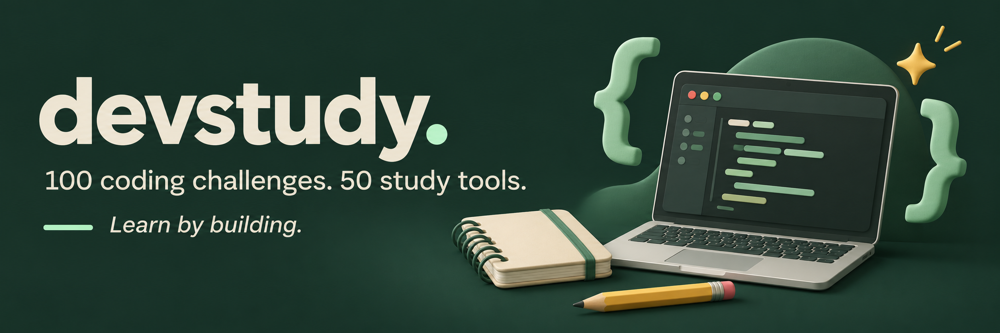
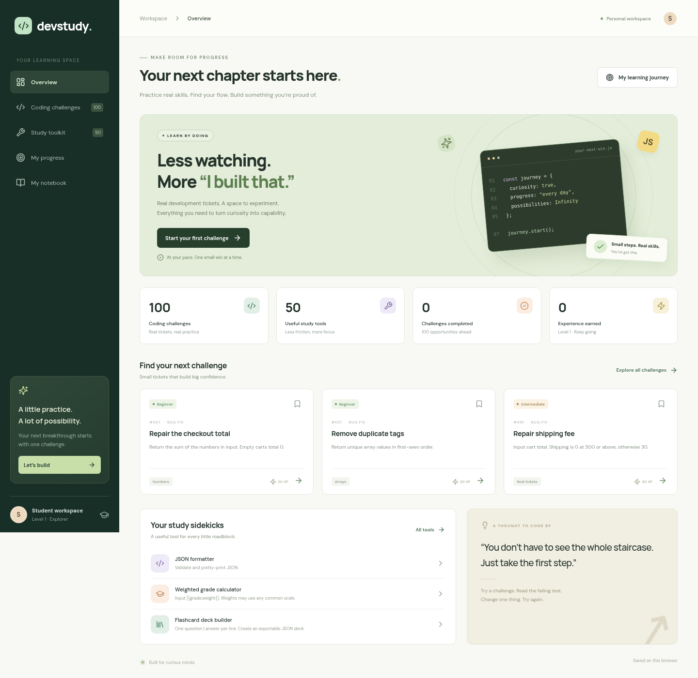
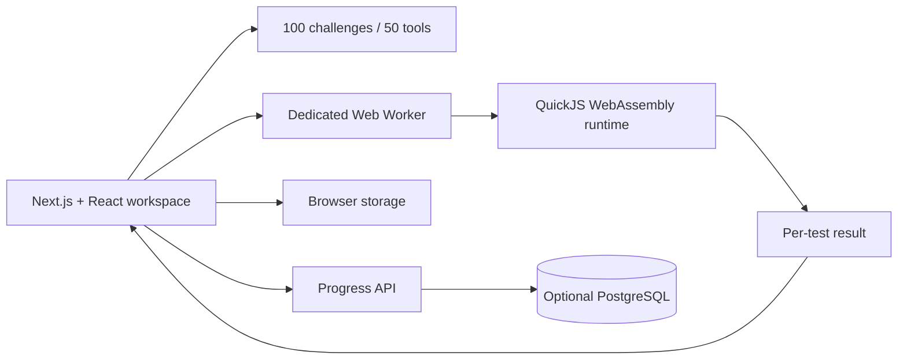
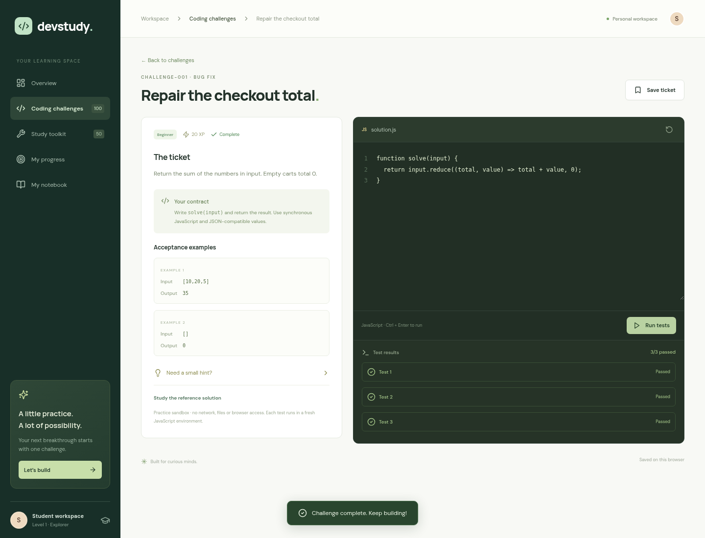

# DevStudy



A personal learning workspace with **100 JavaScript challenges, 308 acceptance cases and 50 functional study tools**. Practice fixing bugs, implementing features and reviewing code, then track what you have learned.



## Run locally

Requires Node.js 22 or later and npm.

```sh
npm ci
npm run dev
```

Open http://localhost:3000. No API keys or database are required for browser-local use. The development script bundles the WebAssembly runner before starting Next.js.

```sh
npm test                 # challenge, tool, isolation and persistence tests
npm run typecheck
npm run build
npm start
npm run test:browser     # end-to-end browser flows
```

Before the first browser test, run `npx playwright install chromium` (Linux CI: `npx playwright install --with-deps chromium`). The test runner starts a development server on port 3100. You can set `PLAYWRIGHT_CHROMIUM_EXECUTABLE` to use an existing browser.

## What works

- **100 distinct challenges** across numbers, strings, arrays, objects, algorithms, validation, data processing, maths, text processing and practical development tickets.
- Feature exercises start with a stub; bug fixes and code reviews start with intentionally flawed code. Every exercise includes examples, a hint, a reference solution and automated acceptance tests.
- A keyboard-accessible code editor with line numbers, indentation, Ctrl/Cmd+Enter execution, reset, saved drafts and per-test feedback.
- **50 tools:** JSON and CSV utilities, encoders, text utilities, statistics, maths, unit converters, truth tables, grade calculators, revision scheduling, flashcard deck export and study planning.
- Search, category/difficulty filters, bookmarks, XP, levels, skill progress and recent wins.
- An autosaving Markdown notebook with export, plus progress JSON export.
- Responsive desktop and mobile layouts.
- Optional PostgreSQL persistence tied to an opaque HTTP-only browser session.

The current language is **JavaScript**. Tools are deterministic local utilities; no paid AI API is required. This is a personal practice platform, not an authoritative exam/grading service. Reference solutions and acceptance cases are intentionally available to the learner.

## Optional PostgreSQL

Copy `.env.example` to `.env`, uncomment its settings, and replace the password in both `POSTGRES_PASSWORD` and `DATABASE_URL` with the same local password. URL-encode it in the connection string if needed.

```sh
docker compose up -d
npm run dev
```

Compose binds PostgreSQL only to `127.0.0.1:5432` and initializes `scripts/schema.sql` for a new volume. For an existing database, apply that SQL manually:

```sh
psql "$DATABASE_URL" -f scripts/schema.sql
```

`GET /api/progress` loads the current session. `PUT /api/progress` sanitizes and saves progress, drafts and notes using parameterized SQL. Writes require a same-origin request. Set `APP_ORIGIN` to the exact public origin when hosting behind an HTTPS reverse proxy. Browser storage remains the immediate local copy. If the database fails, the interface keeps that copy and reports a sync problem.

There are no accounts or cross-device login yet. Clearing the browser cookie starts a new database session. Browser-local storage is private to the browser profile, not a replacement for separate users on a shared computer. Export your work before clearing browser data. Do not use this session design to store sensitive records.

## Architecture



- `components/workspace.tsx`: navigation, dashboard, editor, tools, progress and notebook.
- `lib/challenges.json`: exercise contracts, deliberately incomplete starters, expected values and reference solutions.
- `lib/tools.ts`: tool registry and implementations.
- `lib/runner.ts`: isolated test execution and structural result comparison.
- `lib/runner.worker.ts`: worker entrypoint; `scripts/build-worker.mjs` bundles it and copies the WASM binary.
- `lib/progress.ts`: progress schema sanitization.
- `app/api/progress/route.ts`: PostgreSQL session persistence.
- `tests/`: automated regression and browser tests.

## Execution boundaries

Student code runs inside **QuickJS compiled to WebAssembly**, hosted in a dedicated browser Web Worker. It is never passed to the host browser's `eval`, `Function`, Node.js `vm`, or a server process. No host functions, network APIs, DOM, filesystem access or module loader are exposed to the guest.

Each acceptance case receives a fresh runtime with a **16 MiB guest heap**, **256 KiB stack** and **600 ms interrupt deadline**. The UI terminates the entire worker after 10 seconds as a second guard. Code is limited to 30,000 characters and serialized output to 100,000 characters. These guest limits are not a hard cap on the worker's total browser-process memory.

Only synchronous JSON-compatible return values are supported. The runner compares arrays in order and objects structurally, with a small tolerance for floating-point arithmetic. Grading and XP are client controlled; do not use them as trusted credentials or leaderboard scores without server verification.

## GitHub

Clone the [public DevStudy repository](https://github.com/ROBIN90089/devstudy).

## Command line

After `npm ci`, list challenges, read a brief, or test a local JavaScript solution:

```sh
npm run cli -- list
npm run cli -- show challenge-001
npm run cli -- run challenge-001 solution.js
```



The included GitHub Actions workflow installs locked dependencies, runs unit tests and type checks, builds production output, and runs browser tests with a PostgreSQL service.

## Extending it

Add a challenge to `lib/challenges.json` with an input/output contract, a reference solution, a starter and boundary cases. Add a tool to `lib/tools.ts` with a distinct purpose, example and implementation. Update the fixed catalogue counts and count tests when expanding beyond 100/50.

Good next milestones are authentication, course lessons, a real code-diff review workflow, additional language runtimes, teacher dashboards and a server-verified submission queue. The current review exercises ask learners to repair a provided implementation; they do not emulate a full GitHub pull request.

## License

MIT. See `LICENSE`.
